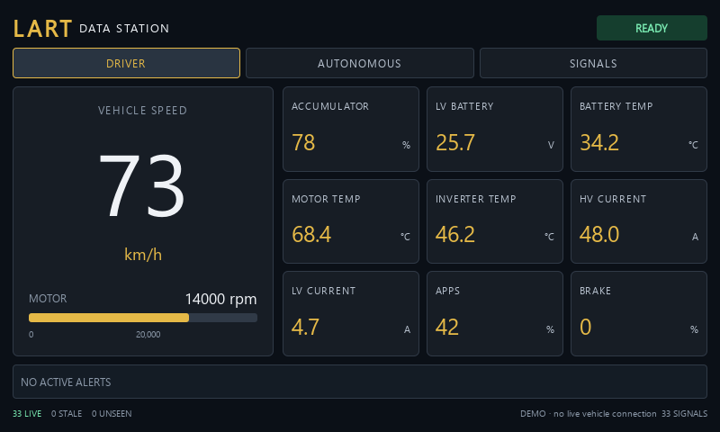
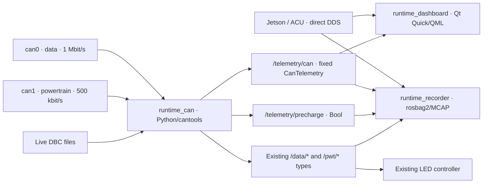

# LART Data Station

Vehicle telemetry, recording and an 800 × 480 driver display for Raspberry Pi 5,
Ubuntu 24.04 and ROS 2 Jazzy. The runtime architecture uses Python and Qt Quick.
DBC files are loaded as data; changing a CAN signal does not generate application
C++ or a new ROS interface.



## Architecture



- **Acquisition:** one validated DBC per CAN interface. Identical IDs on different
  buses stay separate. Generic messages contain timestamps, bus identity, raw
  bytes and flags, exact numeric values, and the DBC SHA-256. Unknown and
  malformed frames still retain their raw data.
- **Interface:** Driver, Autonomous and a searchable Signals page. Signal names
  bind at runtime. New fields appear in Signals automatically. QML controls the
  layout; Python holds calibrated conversions and alert rules. Driver and
  Autonomous refresh at about 30 Hz; Signals refreshes at up to 10 Hz.
- **Recording:** separate process, independent of the interface. Precharge or
  Jetson READY/DRIVING starts a session. Both requests must explicitly clear
  before the 30-second grace period. Publisher silence keeps the last request.
  MCAP records all discovered topics, including hidden topics, except `/zed/*`.
- **Compatibility:** installed `lart_msgs` types and existing CAN topic names
  remain available through an adapter. Newly added signals are immediately
  available in the generic transport. Adding them to an external typed ROS
  contract is a separate interface change and still requires rebuilding that
  contract and its consumers.

The queue is bounded. `/telemetry/status` reports received, published, dropped,
unknown and failed frames per bus. This is not a guarantee of lossless capture.
`/telemetry/dbc_manifest` contains the validated DBC contents, hashes and signal
catalog, including after reload. The manifest is retained for late subscribers
and recorded in each bag.

## Install and build

Run in Bash from the repository root on the target Linux machine:

```bash
git submodule update --init src/lart_msgs
source /opt/ros/jazzy/setup.bash
sudo apt install ros-jazzy-rosbag2-storage-mcap libegl1 libopengl0 \
  libxkbcommon0 libxcb-cursor0 libxkbcommon-x11-0 fonts-dejavu-core
python3 -m pip install --user --break-system-packages -r requirements-runtime.txt
colcon build --base-paths src \
  --packages-up-to data_station_runtime input_handler led_controller sim \
  --parallel-workers 2
source install/setup.bash
```

Install GPIO, LED and uploader dependencies from `requirements.txt` for the full
car installation. The new interface only needs `PySide6-Essentials`; it does not
use Qt WebEngine. Qt's reference platforms include Pi 5 with Ubuntu 24.04;
display drivers and throughput must still be checked on the actual car.
See [Qt supported platforms](https://doc.qt.io/qtforpython-6/overviews/qtdoc-supported-platforms.html).

The ARM64 workflows build packages under `src/` and test the runtime path. They
do not regenerate per-DBC messages or build LVGL. The release asset remains
`lart-dashboard-arm64.tar.gz`, now containing `install/`. The existing
`bash scripts/pull_arm64_build.sh` download command still applies. Install the
runtime Python dependencies before starting a new release.
The downloader defaults to `FSLART/data_station`; set `LART_RELEASE_REPO` when
using a fork. An older asset without the runtime package is rejected before
replacing the installed files.

## Run

Configure SocketCAN once per boot:

```bash
sudo ip link set can0 up type can bitrate 1000000
sudo ip link set can1 up type can bitrate 500000
bash scripts/start_runtime.sh
```

The launcher sets `ROS_DOMAIN_ID=42` unless already supplied, sources ROS and the
workspace, and uses the checkout's live `dbc_signals/` directory. The existing
autostart script selects this runtime by default. To run acquisition and
recording without a display or hardware I/O:

```bash
bash scripts/start_runtime.sh ui:=false hardware_io:=false
```

For a standalone launch, select the live directory explicitly:

```bash
ros2 launch data_station_runtime car.launch.py dbc_dir:="$PWD/dbc_signals"
```

Without `dbc_dir`, launch uses the installed DBC copies. The UI accepts touch,
keys `1`/`2`/`3`, arrow keys, and `std_msgs/Int32` on `/dashboard/set_screen`.
The existing GPIO node currently logs input events; it does not publish screen
commands. Its configuration remains in `lart_bringup/config/rpi_config.yaml`.

## Edit a DBC or screen

After replacing the data or powertrain DBC in the active directory:

```bash
ros2 service call /runtime_can/reload_dbc std_srvs/srv/Trigger '{}'
```

All DBCs must validate before the active schema changes. A failed reload keeps
the previous schema. A successful reload discards queued old-schema frames and
counts that gap as `reload_discarded`. New fields appear in Signals and bags
without regenerating messages or rebuilding the interface. Changes to a field's
meaning, unit or range still require review of driver bindings and calibration.
See [DBC update guide](docs/DBC-Update-Guide.md).

Edit `src/data_station_runtime/data_station_runtime/qml/` for layouts and
`presentation.py` for driver bindings. Restart the interface after QML edits.
With a normal install, rebuild the Python package to copy those files; there is
no C++ compilation. Use `--symlink-install` during local development.

The autonomous DBC describes direct DDS topics. Restart the interface after
changing that catalog. A new external ROS message type must exist on both the
Jetson and Data Station before its typed fields can be consumed.

## Preview and tests

No ROS or CAN is needed for the demo:

```bash
python3 -m pip install -r requirements-runtime.txt pytest
PYTHONPATH=src/data_station_runtime python3 -m data_station_runtime.app --demo
PYTHONPATH=src/data_station_runtime:src/lart_bringup \
  python3 -m pytest -q src/data_station_runtime/test src/lart_bringup/test/test_trigger_state.py
```

The tests cover DBC validation/reload, multiplexing, bus isolation, exact
integers, freshness, calibrated display rules, recorder triggers and QML startup.
ROS integration tests run after the packages are built; they skip on a host
without ROS. ARM64 workflows also exercise generated ROS serialization and
virtual CAN publication/reload.

Run `python3 scripts/benchmark_runtime.py --qt` on the target to measure decoding
and rendering separately. This benchmark does not measure SocketCAN/DDS losses;
check `/telemetry/status` under real traffic too.

## Existing tools and migration

The LVGL/EEZ sources, generators, simulators, Tk admin panel and Foxglove uploader
remain available. `ros2 launch lart_bringup dbc_sim.launch.py` and
`python3 start_admin_panel.py` continue to use the legacy tooling. Do not run the
old and new CAN publishers together on the same topics.

For an explicitly built legacy dashboard, set `LART_LEGACY_UI=1` before running
`LART_Car_Dashboard_v1/autostart_dashboard.sh`. Runtime releases no longer ship
the old C++ UI binary. Build that fallback separately before using it.

[Architecture and migration details](docs/Data-Station-Restructure-Plan.md)
describe the contract boundary and hardware validation still required.
